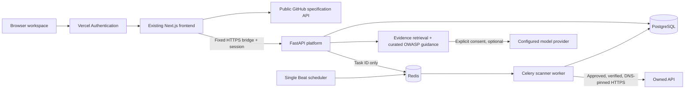

# OnescanX architecture and security model

## Components



The existing Python scanner, local web API and report schema are preserved. The shared HTML/CSS/JS presentation is served by Next.js on Vercel and by Python locally. `platform.js` extends the existing dashboard rather than duplicating the scanner UI. All result counts and comparison data come from loaded reports. A browser-only workspace is useful while cloud services are disconnected.

`platform/server.py` owns validated API contracts and session enforcement; `scope.py` owns public egress and approved credential references; `worker.py` owns asynchronous jobs; `intelligence.py` owns retrieval/model synthesis; `exports.py` owns PDF/CSV; `database.py` owns transactions. API request types are Pydantic models; scan results reuse the versioned `ScanReport` contract and `schemas/report.schema.json`.

## Database schema and migration

Schema v1 is an intentionally small, single-workspace relational envelope:

```sql
CREATE TABLE workspace_records (
  id VARCHAR(64) PRIMARY KEY,
  kind VARCHAR(32) NOT NULL,
  created TIMESTAMP WITH TIME ZONE NOT NULL,
  data JSON NOT NULL
);
CREATE INDEX ix_workspace_records_kind ON workspace_records(kind);
```

| `kind` | JSON data |
| --- | --- |
| asset | name, exact target, specification, spec digest, fixture references, operations, challenge, verification expiry |
| job | asset ID, queued/running/complete/error status, report ID or sanitized error |
| report | typed report, source (`worker` or `import`) |
| schedule | asset ID, interval hours, next UTC run, enabled |
| session | expiry; primary key is SHA-256 of the random session token |
| audit | action, record ID, UTC timestamp; no raw credentials |

All SQL parameters are bound by SQLAlchemy. JSON references are application-level relationships in this MVP, not foreign keys. `python -m api_sentry.platform.migrate` idempotently creates schema v1; it performs no destructive migrations. Back up the database before schema changes. Introduce explicit versioned migrations and normalized relations before evolving this schema. Lists return the latest 200 records; device saves retain at most ten reports. Retention/pagination beyond those limits is roadmap work; records are not automatically purged.

## Trust boundaries

- This is a **single-operator MVP**, not a tenant-isolated SaaS. The operator has access to all records. Do not issue the operator password to independent customers.
- Hosted website authentication remains Vercel Deployment Protection. Backend sessions use a random 256-bit token, an eight-hour expiry and Secure/HttpOnly/SameSite=Strict cookies. Raw session tokens are never persisted. Backend authorization is checked on every data API request.
- State changes require an explicitly allowed Origin or a fixed server-to-server bridge key. The bridge separately enforces browser same-origin requests. Per-process limits are 10 login attempts/minute and 120 other API requests/minute, shared across the operator workspace.
- An exact operator-approved HTTPS API root **and** a successful public ownership challenge are required before scans. Workers recheck approval and ownership expiry at execution. No scanner jobs are run inside Vercel request handlers.
- DNS is resolved at each request; all answers must be public. Connections use the validated IP while retaining the original Host header and TLS SNI/certificate identity. Redirects are never followed. The original scanner constrains request paths to the API root. Target-supplied server URLs are ignored.
- Platform fixture references must match `ONESCANX_SCAN_[A-Z0-9_]+`; infrastructure/provider secrets cannot be selected. Credentials are loaded in the worker, never placed in the Redis payload, and redacted from generated reports. Do not put literals into fixtures/specifications/imported reports.
- HTML and PDF text are escaped, CSV formula prefixes neutralized, and report counts recomputed on import. Exports retain original verification and confidence distinctions. Imported reports are user-provided evidence, not signed attestations.
- AI input is untrusted data, carried in a user message separated from a fixed system policy. Retrieval includes selected metadata and bundled guidance only, with no model tools. Citation IDs are validated against retrieved findings. No model-generated finding or severity update is accepted. These structural controls limit prompt-injection impact; they do not prove generated prose is truthful. UI always labels it advisory.

## Operational limits

One API process, one Celery worker (concurrency 1), one Beat scheduler. The current queue is best-effort: there is no exactly-once execution, distributed claim/lease, or automatic recovery of interrupted jobs. A crashed job may require manually queueing another assessment. Ownership expires after seven days; no automatic renewal. Rate-limit counters are process-local, so put a shared limiter in front before scaling.

Worker checks remain bounded, read-only HTTP methods; even GET requests can have effects on a poorly designed API, so use staging fixtures. Platform workers deliberately exclude active injection and burst checks. The existing CLI/local runner retains those opt-in capabilities. No external third-party target was used for development tests.

PostgreSQL/Redis/LLM hosting, backups, monitoring, TLS provisioning, provider costs, multi-tenant authorization and secret rotation are operator responsibilities. Docker defaults are loopback development settings, not an internet-facing deployment template.
